<div align="center">

<picture>
  <source media="(prefers-color-scheme: dark)" srcset="docs/banner.png">
  <source media="(prefers-color-scheme: light)" srcset="docs/banner.png">
  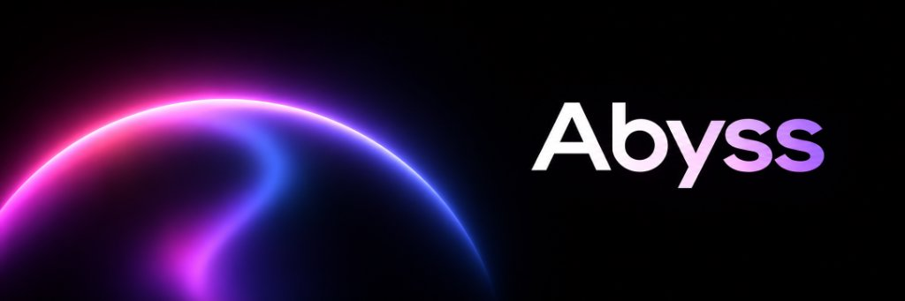
</picture>

<br/>

# ABYSS

> Engineered for uncompromising listening freedom. Free software for everyone.

<p align="center">
  A native, serverless Android music application engineered with Jetpack Compose, AndroidX Media3, Room, and a decoupled stream intelligence pipeline.
</p>

<p align="center">
  <a href="LICENSE"></a>
  <a href="version.properties"></a>
  <a href="docs/BUILD_AND_TEST.md"></a>
  <a href="docs/ARCHITECTURE.md"></a>
  <a href="docs/PRIVACY_AND_PERMISSIONS.md"></a>
</p>

<p align="center">
  <a href="#1-introduction-and-philosophy"><b>OVERVIEW</b></a> &nbsp;&bull;&nbsp;
  <a href="#2-application-interface"><b>SCREENSHOTS</b></a> &nbsp;&bull;&nbsp;
  <a href="#3-system-architecture"><b>ARCHITECTURE</b></a> &nbsp;&bull;&nbsp;
  <a href="#4-persistent-playlist-intelligence"><b>PLAYLIST INTELLIGENCE</b></a> &nbsp;&bull;&nbsp;
  <a href="#5-feature-catalogue"><b>FEATURES</b></a> &nbsp;&bull;&nbsp;
  <a href="#6-providers-and-integrations"><b>PROVIDERS</b></a> &nbsp;&bull;&nbsp;
  <a href="#7-technology-stack"><b>TECH STACK</b></a> &nbsp;&bull;&nbsp;
  <a href="#8-repository-structure"><b>STRUCTURE</b></a> &nbsp;&bull;&nbsp;
  <a href="#9-installation-and-requirements"><b>INSTALLATION</b></a> &nbsp;&bull;&nbsp;
  <a href="#10-building-from-source"><b>BUILD</b></a> &nbsp;&bull;&nbsp;
  <a href="#11-configuration"><b>CONFIG</b></a> &nbsp;&bull;&nbsp;
  <a href="#12-privacy-and-data-handling"><b>PRIVACY</b></a> &nbsp;&bull;&nbsp;
  <a href="#13-security-and-permissions"><b>PERMISSIONS</b></a> &nbsp;&bull;&nbsp;
  <a href="#14-testing-and-quality-assurance"><b>TESTING</b></a> &nbsp;&bull;&nbsp;
  <a href="#15-contributing"><b>CONTRIBUTE</b></a> &nbsp;&bull;&nbsp;
  <a href="#16-licence-and-provenance"><b>LICENCE</b></a> &nbsp;&bull;&nbsp;
  <a href="#17-documentation-index"><b>DOCS</b></a> &nbsp;&bull;&nbsp;
  <a href="#18-ai-assisted-development-disclosure"><b>DISCLOSURE</b></a>
</p>

</div>

---

> [!IMPORTANT]
> **Independent Open-Source Notice:** ABYSS is an independent, community-driven free software project distributed under the GNU General Public Licence v3.0. ABYSS is neither a commercial streaming service nor a music hosting platform; it does not operate proprietary media servers, distribute audio files, or own the music catalogues accessed. The application executes entirely client-side, interacting with publicly available network endpoints and local device storage under the user's direct supervision and control.

---

## 1. Introduction and Philosophy

Modern mobile media software is frequently designed to constrain listener choice. Commercial clients routinely subordinate personal listening preferences to algorithmic promotional campaigns, restrict offline flexibility, enclose user libraries within proprietary walled gardens, and deploy telemetry trackers that compromise user privacy.

**ABYSS** was conceived and engineered to establish a transparent, robust, and dignified alternative:

- **Uncompromising Listening Freedom:** Listeners retain uninhibited authority over their playback queues, local storage, playlist structures, and audio configurations.
- **Strictly Free and Open-Source Software:** Distributed under the GNU General Public Licence v3.0, ensuring full transparency, auditability, and preservation of user software freedoms.
- **Client-Side Autonomy:** ABYSS requires no centralised proprietary user accounts, subscription credentials, or application backend infrastructure. All database queries, stream resolutions, and playlist operations execute locally on the host device.
- **Respect for Listener Privacy:** The application includes zero telemetry libraries, tracking beacons, advertising frameworks, or behavioural profiling SDKs. External network requests are restricted strictly to fetching audio streams, metadata, canvas artwork, and synchronised lyrics.
- **Sound Engineering Quality:** Built with modern Android architectural components, including AndroidX Media3, Jetpack Compose, Room persistence, Kotlin Coroutines, and Dagger Hilt dependency injection.

### Technical Identity & Package Nomenclature

To preserve database migration history, existing user installations, media download structures, and local SQLite data, the project maintains strict technical package stability:
- **Public Product Name:** ABYSS
- **Android Application ID:** `com.napster.music` (configured permanently in `defaultConfig.applicationId`)
- **Internal Kotlin Namespace:** `com.rift.music` (configured in `android.namespace` across all source sets)

This distinction maintains continuity across historical updates while presenting a cohesive, professional identity to listeners.

---

## 2. Application Interface

The screenshots below depict the actual ABYSS user interface running on an Android Virtual Device (API level 36, 1080 &times; 2400 resolution) in standard release configuration.

<table>
  <tr>
    <td width="33.3%" align="center">
      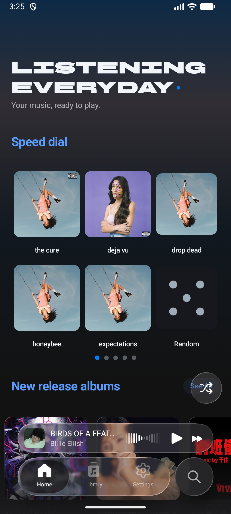
      <br/>
      <sub><b>Home Dashboard</b><br/>Speed dial tiles, dynamic greeting, random discovery, and glassmorphic floating navigation pill.</sub>
    </td>
    <td width="33.3%" align="center">
      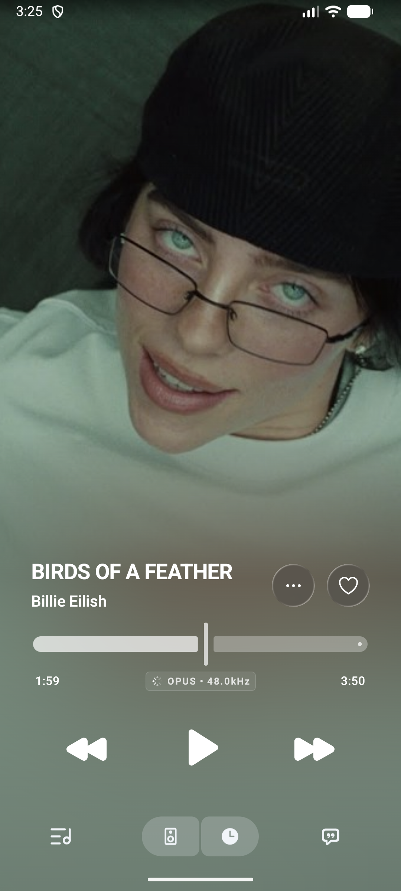
      <br/>
      <sub><b>Now Playing View</b><br/>Visual canvas video background, Opus format indicator, timeline scrubber, and transport controls.</sub>
    </td>
    <td width="33.3%" align="center">
      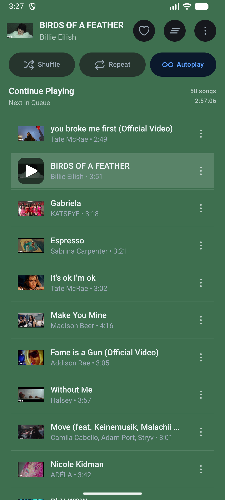
      <br/>
      <sub><b>Queue Management</b><br/>Sequential playback queue, active track tracking, and toggles for shuffle, repeat, and autoplay.</sub>
    </td>
  </tr>
  <tr>
    <td width="33.3%" align="center">
      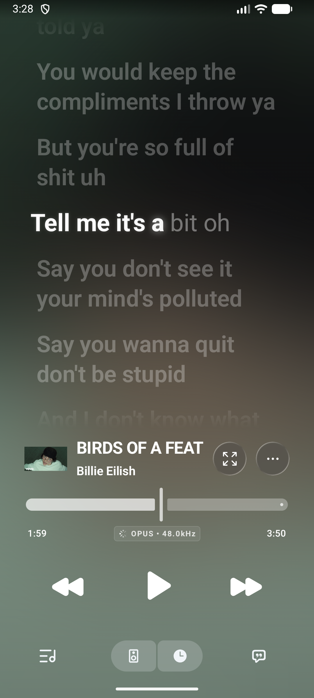
      <br/>
      <sub><b>Synchronised Lyrics</b><br/>Word-by-word synchronised lyric highlighting with glowing typography and blurred artwork backing.</sub>
    </td>
    <td width="33.3%" align="center">
      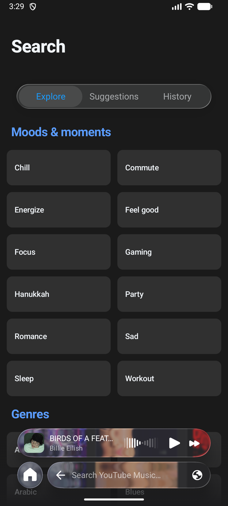
      <br/>
      <sub><b>Search & Discovery</b><br/>Multi-tab exploration featuring categorised Moods & moments, Genres, and real-time query suggestions.</sub>
    </td>
    <td width="33.3%" align="center">
      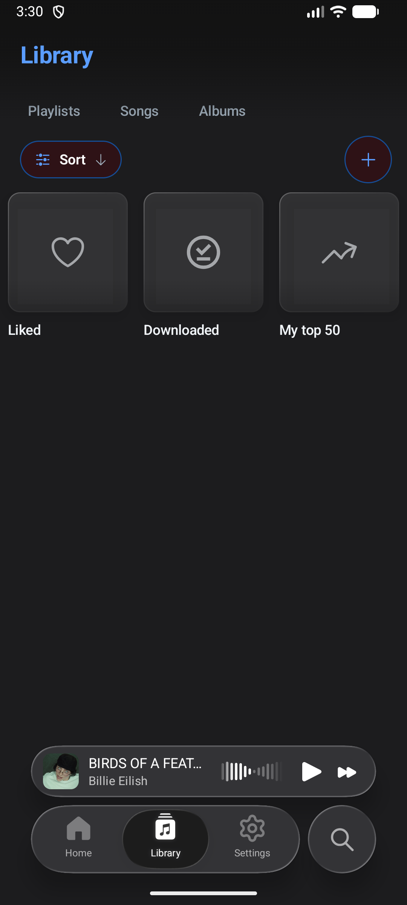
      <br/>
      <sub><b>Library & Collections</b><br/>Local collections, playlist sorting, downloaded audio storage, and smart Liked / Top 50 shelves.</sub>
    </td>
  </tr>
  <tr>
    <td width="33.3%" align="center">
      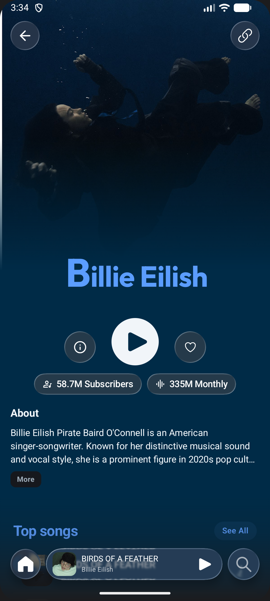
      <br/>
      <sub><b>Artist Details</b><br/>Full artist profile page displaying subscriber metrics, monthly listener counts, biography, and top songs.</sub>
    </td>
    <td width="33.3%" align="center">
      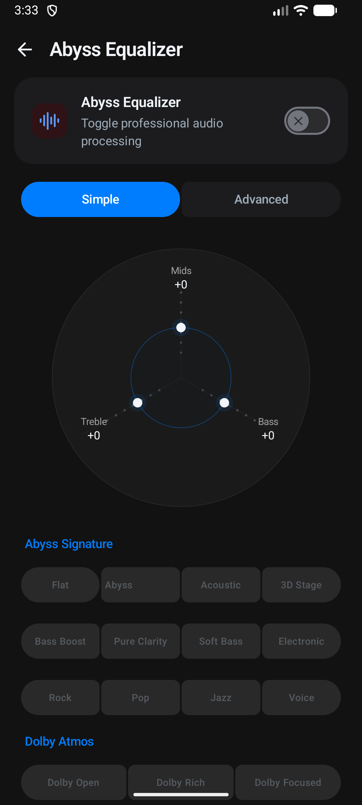
      <br/>
      <sub><b>Abyss Equaliser & DSP</b><br/>Radial 3-point acoustic tuning dial, Abyss signature acoustic profiles, and Dolby Atmos audio modes.</sub>
    </td>
    <td width="33.3%" align="center">
      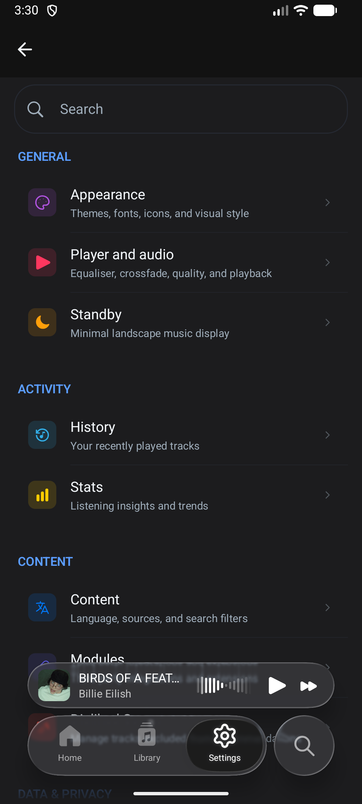
      <br/>
      <sub><b>System Preferences</b><br/>Granular controls for audio crossfade, offline storage, appearance, Standby mode, and privacy.</sub>
    </td>
  </tr>
</table>

---

## 3. System Architecture

ABYSS follows a modularised Clean Architecture pattern with unidirectional data flow (MVI) powered by Kotlin Coroutines and StateFlow. UI components remain strictly decoupled from playback session management and background stream extraction.

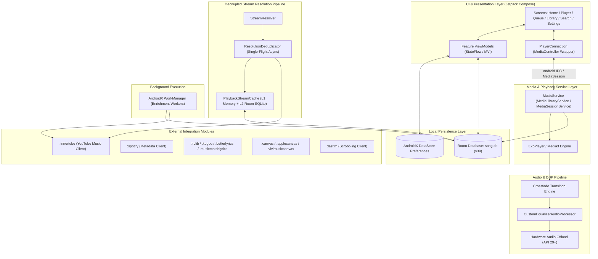

### Layer Responsibilities

- **Presentation Layer:** Built entirely in declarative Jetpack Compose. Screens communicate with domain logic through immutable state containers. The floating navigation pill, wave visualizers, smooth corner surfaces, and dynamic theme paletting adapt seamlessly across phone, foldable, tablet, and landscape Standby orientations.
- **Service Layer:** `MusicService` extends `androidx.media3.session.MediaLibraryService`, providing standard Android media session coordination, background playback continuation, audio focus arbitration, lock-screen controls, and Android Auto integration.
- **Audio Processing Layer:** Implements `CustomEqualizerAudioProcessor` within the ExoPlayer audio sink pipeline, enabling pre-amp gain adjustment, band-level equalisation, radial tonal shaping, and beat-aware crossfading without external audio server dependencies.
- **Stream Resolution Pipeline:** Shields playback from network latency through multi-layered resolution. Resolves track metadata independently from playable streams, maintaining single-flight request deduplication via `ResolutionDeduplicator`.
- **Persistence Layer:** Uses AndroidX Room (`song.db`, schema version 39) with WAL (Write-Ahead Logging) mode enabled for high-throughput concurrent reads and writes, alongside AndroidX DataStore for user preferences.

---

## 4. Persistent Playlist Intelligence

Managing expansive personal music libraries (containing upwards of 4,000 tracks per playlist) introduces severe architectural challenges for mobile clients: network rate-limiting, SQLite foreign key constraint failures, process termination during imports, and ephemeral playback URL expiration.

ABYSS resolves these vulnerabilities through **Persistent Playlist Intelligence**, a decoupled three-tier persistence and stream resolution architecture:

```mermaid
sequenceDiagram
    autonumber
    actor User as Listener
    participant UI as SpotifyImportUI
    participant Importer as SpotifyPlaylistImporter
    participant DB as Room Database (song.db)
    participant WM as WorkManager (Background)
    participant Res as TrackResolutionEngine
    participant YT as InnerTube Client
    participant Cache as PlaybackStreamCache

    User->>UI: Input Spotify Playlist URL / ID
    UI->>Importer: Begin Playlist Import
    Importer->>Importer: Fetch Track Metadata Pages (Public API)
    
    rect rgb(20, 25, 35)
        Note over Importer,DB: Tier 1: Immediate Metadata Persistence
        Importer->>DB: Batch Insert SongEntity (sourceId = "spotify:id")
        Importer->>DB: Batch Insert AlbumEntity & ArtistEntity
        Importer->>DB: Batch Insert PlaylistSongMapEntity
        DB-->>UI: 100% Tracks Visible & Browsable Offline
    end

    rect rgb(25, 35, 45)
        Note over Importer,WM: Tier 2: Provider Identity Mapping
        Importer->>Res: Eagerly Resolve First 5 Tracks
        Res->>YT: Search Best Match (Title + Artist + Clean Album)
        YT-->>Res: Return YouTube videoId
        Res->>DB: Insert ProviderMappingEntity (spotify:id -> videoId)
        Importer->>WM: Enqueue Background Enrichment Worker (Remaining Tracks)
        WM->>Res: Process Queued Tracks with Exponential Backoff
        Res->>DB: Update ProviderMappingEntity
    end

    rect rgb(35, 25, 45)
        Note over User,Cache: Tier 3: Temporary Playback Stream Resolution
        User->>UI: Tap Play on Track
        UI->>Res: Request Playable Stream
        Res->>DB: Check ProviderMappingEntity (Fetch providerTrackId)
        Res->>Cache: Inspect L1 Memory & L2 Room Cache
        alt Cache Hit & Not Expired
            Cache-->>UI: Return Cached Audio Stream URL
        else Cache Miss or Expired
            Res->>YT: Fetch Playback Manifest (iOS Client Bypass)
            YT-->>Res: Return Direct Audio Stream + Expiry Timestamp
            Res->>Cache: Write PlaybackStreamCacheEntity (with 10-min safety margin)
            Res-->>UI: Initiate Playback in ExoPlayer
        end
    end
```

### The Three-Tier Decoupling Model

1. **Tier 1: Persistent Track Metadata (`SongEntity`, `AlbumEntity`, `ArtistEntity`)**
   - Tracks imported from external sources (e.g. Spotify playlists) are written to SQLite immediately using deterministic source identifiers (`spotify:<track_id>`).
   - Insertion ordering ensures parent `SongEntity` records are committed before foreign-keyed `PlaylistSongMap` records, eliminating SQLite code 787 foreign key constraint violations.
   - The entire playlist is 100% visible, searchable, and organisable offline within seconds, without waiting for audio stream lookups.

2. **Tier 2: Persistent Provider Identity Mapping (`ProviderMappingEntity`)**
   - Decouples metadata identity from streaming provider endpoints (`sourceId -> providerTrackId`, e.g. `spotify:6rqhFgbbKwnb9MLmUQDhG6` mapped to YouTube `videoId:2G_Z944qlnM`).
   - The first five tracks are resolved eagerly to permit instantaneous playback. The remaining tracks are handed to an AndroidX `WorkManager` background job that executes with exponential backoff and network-throttling mitigation.
   - Employs a multi-pass fallback scoring heuristic:
     1. Pass 1: Strict normalised matching (`Title + Artist + Clean Album`).
     2. Pass 2: Relaxed matching (`Title + Artist`).
     3. Pass 3: Transformed query stripped of soundtrack or deluxe edition qualifiers.

3. **Tier 3: Temporary Playback Stream Information (`PlaybackStreamCacheEntity`)**
   - Direct media URLs provided by audio endpoints are ephemeral and carry explicit expiration parameters (the `expire=` URL timestamp).
   - ABYSS maintains a two-layer cache: an in-memory L1 cache for instant track transitions and a persistent Room L2 cache that survives application restarts.
   - Stream records enforce a **10-minute safety window**: if a URL expires within 10 minutes, the cache treats it as expired and initiates a silent background refresh.
   - Any HTTP 403 (Forbidden), 404 (Not Found), or 416 (Range Not Satisfiable) error instantly invalidates the cache entry and triggers single-flight resolution deduplication via `ResolutionDeduplicator`.

---

## 5. Feature Catalogue

### Listening Experience & Playback Control
- **Format Reproduction:** Plays Opus, AAC, MP3, FLAC, and Vorbis audio streams up to high-bitrate thresholds.
- **Audio Offload:** Supports hardware-level audio offload on Android 10+ (API 29+) to minimise power consumption during extended headphone listening.
- **Seamless Crossfade:** Configurable crossfade duration (0 to 12 seconds) smoothly interpolates volume between consecutive tracks.
- **Manual Skip Crossfade:** Applies smooth fade-in and fade-out envelopes when skipping manually between tracks.
- **Silence Elimination:** Automatic silence detection skips lead-in and lead-out gaps between audio tracks without playback stutter.
- **Audio Normalisation:** Automatic gain adjustment based on ReplayGain and loudness metadata prevents jarring volume fluctuations across disparate albums.
- **Playback Restoration:** Remembers complete playback queue state, seek positions, and repeat modes across system restarts.

### Acoustic Engineering & Equaliser
- **Radial Tonal Dial:** Intuitive 3-point radial tuning wheel providing real-time shaping across Lows (Bass), Mid-range, and Highs (Treble).
- **Abyss Signature Presets:** Tailored hardware curves for Flat, Abyss Deep, Acoustic, 3D Stage, Bass Boost, Pure Clarity, Soft Bass, Rock, Pop, Jazz, Electronic, and Voice.
- **Dolby Atmos Profiles:** Tuned spatial profile configurations for Dolby Open, Dolby Rich, and Dolby Focused acoustic envelopes.
- **Pre-Amp Gain Control:** Granular pre-amplification scaling to prevent clipping on high-gain headphones.

### Music Discovery & Metadata
- **Multi-Tab Search:** Unified search interface providing instant auto-complete suggestions, browsing history, and genre hubs.
- **Moods & Moments:** Categorised musical hubs for Chill, Commute, Energize, Feel Good, Focus, Gaming, Party, Romance, Sad, Sleep, and Workout.
- **Complete Artist Profiles:** High-resolution artist banners, subscriber statistics, monthly listener figures, biographical summaries, and chronologically indexed album catalogues.
- **Album & Single Repositories:** Detailed album presentations featuring track listings, release years, record label attributions, and total duration metrics.

### Synchronised Lyrics & Visual Canvas
- **Synchronised Karaoke Highlighting:** Word-by-word synchronised lyric highlighting with glowing typography.
- **Multi-Source Provider Engine:** Aggregates lyrics dynamically across LRCLIB, KuGou, BetterLyrics, Musixmatch, Paxsenix, and YouLyPlus.
- **Full-Screen Lyric Theatre:** Expands lyrics into a dedicated full-screen presentation mode designed for tablets and landscape displays.
- **Looping Canvas Video:** Fetches and loops visual background canvases from Apple Music, Vivi Music, and artist video feeds.

### Library Organisation & Data Management
- **Local & Remote Convergence:** Displays local on-device audio files alongside cloud-streamed favourites in unified shelves.
- **Smart Playlists:** Automated smart collections for Liked Tracks, Downloaded Audio, and Top 50 Most Played.
- **Selective Folder Scanning:** Customisable inclusion and exclusion lists for local folder indexing.
- **Flexible Sorting:** Sort playlists and tracks by date added, title, artist, album, or release year.
- **Full Library Backup:** Export and import complete Room databases and DataStore preferences in JSON format for offline migration.

### Android System Integration
- **MediaSession & Notification:** Compliant with Android 13+ media control standards, featuring dynamic palette colouring and scrubbable seekbars.
- **Android Auto Compatibility:** Direct integration with Android Auto head units (`com.google.android.gms.car.application`), enabling safe hands-free playback, playlist selection, and queue navigation while driving.
- **Home-Screen Widgets:** Three thoughtfully designed native Android home-screen widgets:
  - *Abyss Dot Player:* Compact 2&times;2 interactive mini-player.
  - *Abyss Lyrics Player:* Wide 2&times;4 split-panel widget displaying real-time synchronised lyrics.
  - *Abyss Vinyl Deck:* Vintage 2&times;4 rotating vinyl turntable widget with tactile controls.
- **Standby Mode:** Minimalist horizontal display mode featuring large clock, track metadata, and subtle controls for nightstand docking.
- **Dynamic Launcher Icons:** In-app selection of custom application launcher icons and monochrome themed icons.

---

## 6. Providers and Integrations

ABYSS aggregates external audio, metadata, canvas artwork, and synchronised lyrics via dedicated, sandboxed Gradle modules. No proprietary API keys are mandatory for core functionality.

| Module | Integration Target | Role & Capabilities | Authentication |
|---|---|---|---|
| `:innertube` | YouTube Music | Primary search, track metadata, artist profiles, audio stream manifests, and related recommendations. | None (Public client bypass) |
| `:spotify` | Spotify Web API | Public playlist imports, album tracklists, and metadata extraction. | Client Credentials (Auto-fetched anonymously) |
| `:lrclib` | LRCLIB | Open-source community synchronised and plain-text lyrics. | None |
| `:kugou` | KuGou Music | High-accuracy synchronised lyrics and bilingual translations. | None |
| `:betterlyrics` | BetterLyrics | Enhanced synchronised lyric streams and syllable-timed transcripts. | None |
| `:musixmatchlyrics` | Musixmatch | Tokenised synchronised lyric provider. | Anonymous Token |
| `:paxsenixlyrics` | Paxsenix | Community-hosted lyric endpoint. | None |
| `:youlyplus` | YouLyPlus | Fallback synchronised lyric provider. | None |
| `:canvas` / `:applecanvas` | Apple Music Canvas | Looping short-form video artwork for active playback screens. | None |
| `:vivimusiccanvas` | Vivi Music Canvas | Canvas video loops and aesthetic motion backdrops. | None |
| `:artistvideo` | Artist Video Feeds | Artist promotional video stream backdrops. | None |
| `:jiosaavn` | JioSaavn | Regional music catalogue search and stream metadata provider. | None |
| `:lastfm` | Last.fm & ListenBrainz | Real-time playback scrobbling and now-playing status updates. | User API Key & Secret (Optional) |
| `:spine` | Spine Audio | Auxiliary audio stream resolution pipeline. | None |

---

## 7. Technology Stack

The application dependencies and version constraints are defined in `gradle/libs.versions.toml` and verified against the build configuration:

| Component | Library / Framework | Version | Purpose |
|---|---|---|---|
| **Language** | Kotlin | `2.3.10` | First-class modern language with strict coroutines and serialization. |
| **Build Tool** | Android Gradle Plugin (AGP) | `9.2.1` | Modern Android build pipeline with KSP and R8 optimisations. |
| **UI Framework** | Jetpack Compose | `1.10.2` | Fully declarative UI toolkit with adaptive layouts. |
| **Design System** | Material 3 & Adaptive | `1.5.0-alpha18` | Dynamic Material You theming and foldable/tablet window size adaptivity. |
| **Media Engine** | AndroidX Media3 | `1.7.1` | Core ExoPlayer audio pipeline, `MediaSessionService`, and HLS streaming. |
| **Local Database** | AndroidX Room | `2.8.4` | SQLite object mapping with schema v39 and WAL concurrency. |
| **Preferences** | AndroidX DataStore | `1.2.0` | Type-safe asynchronous key-value persistence. |
| **Dependency Injection** | Dagger Hilt | `2.59.1` | Compile-time dependency injection across services and ViewModels. |
| **Network Client** | Ktor Client & OkHttp | `3.4.0` | High-throughput asynchronous HTTP client engine. |
| **Image Loading** | Coil Compose | `3.3.0` | Asynchronous image decoding for covers, avatars, and GIF/SVG assets. |
| **Background Tasks** | AndroidX WorkManager | `2.10.0` | Guaranteed background execution for playlist enrichment and caching. |
| **HTML Parsing** | Jsoup | `1.22.1` | Robust HTML parsing for web-scraped metadata fallback pipelines. |
| **JavaScript Engine** | QuickJS Android | `1.0.5` | Lightweight client-side ECMAScript runtime for cipher deobfuscation. |
| **Stream Extraction** | NewPipeExtractor | `v0.25.2` | Community-maintained extraction engine for public media endpoints. |
| **Logging** | JakeWharton Timber | `5.0.1` | Structured debug logging with zero release-build overhead. |

---

## 8. Repository Structure

The ABYSS repository is partitioned into modular Gradle projects, ensuring strict separation of concerns, fast incremental build times, and isolated network layers:

```
Abyss/
├── app/                                 # Primary Android application module
│   ├── src/main/AndroidManifest.xml     # Application manifest, permissions, and services
│   ├── src/main/kotlin/com/rift/music/
│   │   ├── app/                         # App lifecycle, MainActivity, and crash reporting
│   │   ├── constants/                   # PreferenceKeys, dimension tokens, and defaults
│   │   ├── db/                          # Room Database (MusicDatabase v39), entities, DAOs
│   │   ├── di/                          # Dagger Hilt dependency injection modules
│   │   ├── eq/                          # CustomEqualizerAudioProcessor & EqualizerService
│   │   ├── feature/                     # Feature UI screens (Home, Player, Search, Library, Settings)
│   │   ├── playback/                    # MusicService, PlayerConnection, and ExoDownloadService
│   │   ├── widget/                      # Android home-screen widget receivers and layouts
│   │   └── utils/                       # Audio utilities, cipher helpers, and format parsers
│   └── src/test/kotlin/                 # Extensive unit and migration test suites
├── innertube/                           # Unofficial YouTube Music API client and format parsers
├── spotify/                             # Spotify public playlist importer and track metadata client
├── lrclib/                              # LRCLIB open-source synchronised lyrics provider
├── kugou/                               # KuGou lyrics and bilingual translation client
├── betterlyrics/                        # BetterLyrics syllable-timed lyrics integration
├── musixmatchlyrics/                    # Musixmatch tokenised lyrics provider
├── paxsenixlyrics/                      # Paxsenix lyric endpoint integration
├── youlyplus/                           # YouLyPlus lyric provider integration
├── canvas/                              # Base canvas artwork and motion video abstractions
├── applecanvas/                         # Apple Music canvas video provider
├── vivimusiccanvas/                     # Vivi Music canvas video integration
├── artistvideo/                         # Artist background video stream provider
├── jiosaavn/                            # JioSaavn stream and search provider
├── lastfm/                              # Last.fm and ListenBrainz scrobbling integration
├── spine/                               # Auxiliary stream resolution pipeline
├── gradle/                              # Version catalogs (libs.versions.toml) and wrapper
├── docs/                                # Technical documentation, architecture guides, and screenshots
│   ├── images/screenshots/              # Genuine captured application screenshots
│   ├── ARCHITECTURE.md                  # Comprehensive architectural specification
│   ├── PLAYBACK.md                      # Detailed playback and media session engine guide
│   ├── PERSISTENT_PLAYLIST_INTELLIGENCE.md # Three-tier playlist and cache documentation
│   ├── README_AUDIT.md                  # Technical verification and documentation audit
│   └── BUILD_AND_TEST.md                # Compilation, signing, and test documentation
├── version.properties                   # Single source of truth for semantic versioning
├── build.gradle.kts                     # Root build configuration
└── settings.gradle.kts                  # Gradle multi-module project registry
```

---

## 9. Installation and Requirements

### System Requirements
- **Minimum Android Version:** Android 8.0 Oreo (API level 26)
- **Target Android Version:** Android 15 (API level 36)
- **Recommended Android Version:** Android 13+ (API level 33+) for native media controls and dynamic theming
- **Supported Architectures:** `arm64-v8a`, `armeabi-v7a`, `x86`, `x86_64`, and Universal

### Build Flavours & Packages

ABYSS provides two distinct release variant distributions:

1. **FOSS Variant (`foss` - Default & Recommended):**
   - 100% Free and Open-Source Software compliant with F-Droid inclusion standards.
   - Zero proprietary Google Play Services binary blobs.
   - Google Cast disabled (`CAST_AVAILABLE = false`).
2. **GMS Variant (`gms`):**
   - Includes Google Cast Framework (`com.google.android.gms:play-services-cast-framework`) for streaming audio to Chromecast and Google Nest devices.

---

## 10. Building from Source

### Prerequisites
- **JDK:** Java Development Kit 17 or 21 (Temurin or OpenJDK recommended)
- **Android SDK:** Installed with Platform API 36/37 and Build-Tools 36.x
- **Android NDK:** Version `27.0.12077973`

### Step-by-Step Compilation

1. **Clone the Repository:**
   ```bash
   git clone https://github.com/slythnox/Abyss.git
   cd Abyss
   ```

2. **Assemble Debug Build (Universal FOSS):**
   ```bash
   ./gradlew assembleUniversalFossDebug
   ```
   The resulting APK is written to:
   `app/build/outputs/apk/universalFoss/debug/Abyss-universal-foss-debug.apk`

3. **Assemble Release Build (Universal FOSS):**
   ```bash
   ./gradlew assembleUniversalFossRelease
   ```
   The resulting APK is written to:
   `app/build/outputs/apk/universalFoss/release/Abyss-universal-foss-release-unsigned.apk`

4. **Assemble Architecture-Specific Release (e.g. ARM64):**
   ```bash
   ./gradlew assembleArm64FossRelease
   ```

5. **Execute Unit Tests:**
   ```bash
   ./gradlew testUniversalFossDebugUnitTest
   ```

6. **Automated Semantic Version Bumping:**
   ```bash
   ./gradlew bumpVersion -Ppart=patch   # Increments patch (e.g. 1.0.6 -> 1.0.7)
   ./gradlew bumpVersion -Ppart=minor   # Increments minor (e.g. 1.0.7 -> 1.1.0)
   ./gradlew bumpVersion -Ppart=major   # Increments major (e.g. 1.1.0 -> 2.0.0)
   ```

---

## 11. Configuration

ABYSS is fully functional immediately upon installation without mandatory configuration. Optional provider credentials may be configured locally if desired:

### Optional Last.fm Scrobbling Credentials

To enable native Last.fm or ListenBrainz scrobbling, define credentials in `local.properties` (or as environment variables before building):

```properties
# local.properties (Excluded from Git version control)
LASTFM_API_KEY=your_lastfm_api_key_here
LASTFM_SECRET=your_lastfm_secret_here
```

If left unconfigured, the application builds cleanly with empty strings, and Last.fm scrobbling remains dormant.

---

## 12. Privacy and Data Handling

ABYSS is engineered with privacy as a foundational principle:

- **No Proprietary Backend Infrastructure:** There are no ABYSS-managed servers collecting account details, device identifiers, or listening metrics.
- **Zero Telemetry or Analytics SDKs:** The application does not bundle Firebase Analytics, Google Crashlytics, Mixpanel, Sentry, or any third-party tracking libraries.
- **Local SQLite Data Storage:** All user playlists, search history, liked tracks, and audio preferences are persisted exclusively in the local on-device SQLite database (`song.db`) and AndroidX DataStore files within private application sandboxes.
- **Direct Client-to-Endpoint Network Traffic:** When streaming audio or searching, network requests originate directly from the user's device to the respective provider endpoints (e.g. YouTube Music, Spotify public API, LRCLIB). These requests contain standard HTTP headers necessary to retrieve requested audio or metadata, and no supplementary behavioural telemetry is appended.
- **Full Data Exportability:** Users may export their entire Room database and preferences at any time to inspect, backup, or migrate their data.

---

## 13. Security and Permissions

ABYSS requests only permissions strictly necessary to perform audio playback, background service lifecycle management, and device integration:

| Permission | Android Scope | Technical Rationale |
|---|---|---|
| `android.permission.INTERNET` | All APIs | Fetching audio streams, metadata, lyrics, and canvas artwork from public endpoints. |
| `android.permission.ACCESS_NETWORK_STATE` | All APIs | Monitoring network transitions (Wi-Fi to Mobile) to adjust audio quality preferences dynamically. |
| `android.permission.FOREGROUND_SERVICE` | API 28+ | Maintaining uninterrupted playback while the application is backgrounded. |
| `android.permission.FOREGROUND_SERVICE_MEDIA_PLAYBACK` | API 34+ | Android 14 requirement declaring that the foreground service executes media playback. |
| `android.permission.FOREGROUND_SERVICE_DATA_SYNC` | API 34+ | Required for `ExoDownloadService` and background `SpotifyImportService` synchronisation. |
| `android.permission.WAKE_LOCK` | All APIs | Preventing CPU deep sleep while audio decoding is in progress. |
| `android.permission.POST_NOTIFICATIONS` | API 33+ | Displaying playback controls and artwork in the Android system notification drawer. |
| `android.permission.RECEIVE_BOOT_COMPLETED` | All APIs | Restoring registered alarms or scheduled background work after device reboot. |
| `android.permission.READ_MEDIA_AUDIO` | API 33+ | Indexing and playing local music files stored on the user's device. |
| `android.permission.READ_EXTERNAL_STORAGE` | API 26–32 | Legacy storage permission for local audio playback on Android 12 and below. |
| `android.permission.WRITE_EXTERNAL_STORAGE` | API 26–28 | Legacy permission strictly for saving custom ringtones to public storage on Android 8.0–9.0. |
| `android.permission.BLUETOOTH_CONNECT` | API 31+ | Discovering paired Bluetooth audio devices, A2DP telemetry, and routing status. |

---

## 14. Testing and Quality Assurance

The codebase includes an extensive suite of local JVM unit tests and Room migration verifications:

- **Database Migration Testing:** `DatabaseMigration37To38Test.kt` verifies schema alterations and column additions between successive database versions, guaranteeing zero data loss during migrations.
- **Import & Pagination Robustness:** `SpotifyLargePlaylistImportTest.kt` and `SpotifyImportPaginationTest.kt` validate pagination handling, cancellation recovery, and foreign-key integrity across collections exceeding 4,000 tracks.
- **Playlist Intelligence & Cache Expiry:** `PersistentPlaylistIntelligenceTest.kt` and `LegacyLibraryBackfillCoordinatorTest.kt` ensure that expired stream cache records are purged and that provider mappings resolve deterministically.
- **Playback & Queue Reliability:** `StreamingReliabilityTest.kt`, `AndroidAutoPlaybackQueueTest.kt`, and `RandomDiscoveryQueueTest.kt` verify state continuity across queue mutations and network stalls.
- **Acoustic & Audio Engine Testing:** `BeatTrackerTest.kt`, `EnergyProfileTest.kt`, `KeyDetectorTest.kt`, and `TransitionSelectorTest.kt` validate signal analysis algorithms powering Auto-DJ transitions.

Run the test suite locally with:
```bash
./gradlew testUniversalFossDebugUnitTest
```

---

## 15. Contributing

Contributions to ABYSS are welcome from software engineers, designers, and translators who value listener freedom and high-quality open-source code.

### Guidelines for Contribution
1. **Fork & Branch:** Create a feature branch with a descriptive name (`git checkout -b feature/audio-dsp-enhancement`).
2. **Adhere to Code Standards:** Follow official Kotlin coding conventions and modern Jetpack Compose best practices. Maintain unidirectional data flow in MVI ViewModels.
3. **Preserve Identity Constraints:** Never alter the Android Application ID (`com.napster.music`) or internal Kotlin namespace (`com.rift.music`).
4. **Respect Architecture:** Keep UI screens decoupled from playback internals. Route player commands strictly through `PlayerConnection` and media controllers.
5. **Verify Tests:** Ensure all unit tests pass before opening a Pull Request (`./gradlew testUniversalFossDebugUnitTest`).
6. **Submit PR:** Submit a concise pull request explaining the problem addressed, technical changes introduced, and verification steps performed.

---

## 16. Licence and Provenance

ABYSS is free software released under the terms of the **GNU General Public Licence v3.0** (GPL-3.0).

```
ABYSS — Native Android Music Player
Copyright (C) 2026 ABYSS Contributors

This program is free software: you can redistribute it and/or modify
it under the terms of the GNU General Public Licence as published by
the Free Software Foundation, either version 3 of the Licence, or
(at your option) any later version.

This program is distributed in the hope that it will be useful,
but WITHOUT ANY WARRANTY; without even the implied warranty of
MERCHANTABILITY or FITNESS FOR A PARTICULAR PURPOSE. See the
GNU General Public Licence for more details.

You should have received a copy of the GNU General Public Licence
along with this program. If not, see <https://www.gnu.org/licenses/>.
```

### Upstream Acknowledgements & Historical Lineage

ABYSS is built upon and draws inspiration from pioneering open-source Android audio projects:
- **ViMusic & InnerTune:** Architectural foundations for client-side InnerTube integration and Compose media playback.
- **NewPipe / NewPipeExtractor:** Foundational research and extraction mechanisms for public media endpoints.
- **SimpMusic & RiMusic:** Community insights into media session coordination, lyrics caching, and UI workflows.

All third-party libraries and dependencies are governed by their respective open-source licences as acknowledged in their module directories.

---

## 17. Documentation Index

Comprehensive technical documentation is maintained under the `docs/` directory:

| Document | Description |
|---|---|
| [docs/ARCHITECTURE.md](docs/ARCHITECTURE.md) | Comprehensive system architecture, MVI patterns, and module boundaries. |
| [docs/PLAYBACK.md](docs/PLAYBACK.md) | Detailed media session coordination, ExoPlayer integration, and diagnostics. |
| [docs/PERSISTENT_PLAYLIST_INTELLIGENCE.md](docs/PERSISTENT_PLAYLIST_INTELLIGENCE.md) | The three-tier model, background enrichment, and stream cache mechanics. |
| [docs/SEARCH_AND_SPOTIFY_IMPORT.md](docs/SEARCH_AND_SPOTIFY_IMPORT.md) | Spotify import mechanics, search debouncing, and candidate resolution. |
| [docs/DATABASE_AND_PREFERENCES.md](docs/DATABASE_AND_PREFERENCES.md) | Room SQLite schema v39 reference, entities, DAOs, and DataStore preference keys. |
| [docs/BUILD_AND_TEST.md](docs/BUILD_AND_TEST.md) | Detailed compilation instructions, product flavours, and signing guidance. |
| [docs/PRIVACY_AND_PERMISSIONS.md](docs/PRIVACY_AND_PERMISSIONS.md) | Exhaustive privacy disclosures, permissions justification, and network boundaries. |
| [docs/FEATURES.md](docs/FEATURES.md) | Detailed functional catalogue of implemented user-facing capabilities. |
| [docs/INTEGRATIONS.md](docs/INTEGRATIONS.md) | External provider contracts, lyrics engines, and canvas backdrops. |
| [docs/TROUBLESHOOTING.md](docs/TROUBLESHOOTING.md) | Solutions for common audio decoding, background playback, and import issues. |
| [docs/RELEASE_CHECKLIST.md](docs/RELEASE_CHECKLIST.md) | Pre-release verification procedure, version bumping, and signing verification. |
| [docs/README_AUDIT.md](docs/README_AUDIT.md) | Verification audit certifying all technical facts and captured screenshots. |

---

## 18. Project Roadmap

The development trajectory for ABYSS remains restrained and focused on reliability, performance, and listener control:

- **Current Status (v1.0.7):** Stable release featuring Three-Tier Persistent Playlist Intelligence, 4,000+ track import resilience, multi-provider synchronised lyrics, custom 3-band radial equaliser, and Android Auto integration.
- **Active Maintenance:**
  - Continuous hardening of InnerTube client extractors against upstream endpoint adjustments.
  - Refinement of background `WorkManager` batching for large playlist metadata enrichment.
  - Performance profiling of Compose recomposition counts across large library grids.
- **Future Explorations:**
  - Expanded lossless audio container support and enhanced DSP spatialisation filters.
  - Additional community lyrics provider integrations.
  - Further optimisations for foldable and dual-screen form factors.

---

## 19. Acknowledgements

We express sincere gratitude to the open-source developers, contributors, and reverse-engineers who make independent media software viable on Android:

- The Android Open Source Project (AOSP) and AndroidX team.
- The Jetpack Compose and Media3 engineering teams at Google.
- The NewPipe and TeamNewPipe community for unyielding dedication to open protocols.
- The maintainers of LRCLIB, KuGou, BetterLyrics, and Musixmatch for open lyric indexing.
- Every individual contributor who has tested builds, submitted patches, translated strings, and advocated for listener freedom.

---

## 20. AI-Assisted Development Disclosure

In the spirit of complete engineering transparency, the maintainers disclose that generative artificial intelligence tools (including large language models and automated code assistance systems) may have been utilised during parts of the development lifecycle of ABYSS. These tools may have assisted in tasks such as codebase exploration, interface prototyping, debugging, documentation drafting, test generation, and architectural analysis.

The utilisation of AI assistance in no way diminishes human engineering responsibility. Every architectural decision, code change, database schema migration, and documentation entry is reviewed, validated, and verified by human maintainers. Contributions, whether authored by humans or developed with AI assistance, are evaluated strictly on their technical merits, correctness, maintainability, and alignment with the project's core philosophy of listening freedom.
